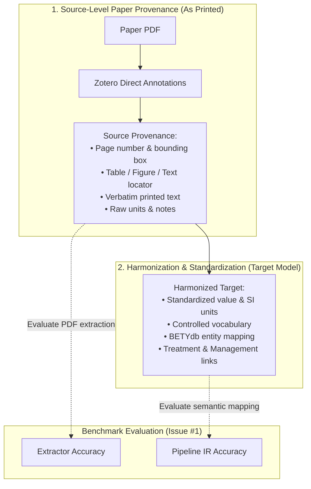

# Gold Dataset Annotation Schema & Curation Guide

**Structured Agronomic and Ecological Data Extraction Generation (SAGE)**  
*Reference: [PecanProject/sage#5](https://github.com/PecanProject/sage/issues/5) & [PecanProject/sage#1](https://github.com/PecanProject/sage/issues/1)*

---

## 1. Overview & Purpose

Benchmarking open-source PDF extractors (Issue #1) requires a ground-truth dataset of agronomic paper extractions — the text, tables, and figures that an extractor parses. This document establishes:

1. **A documented, consistent annotation schema** linking raw paper evidence to harmonized agronomic representations.
2. **Filtering criteria** for curating candidate papers from the BETYdb (`PecanProject/betydata`) citation pool.
3. **Paper acquisition workflows** to download PDFs automatically via DOI and Open Access endpoints.
4. **Tooling and CLI commands** to filter papers, build manifests, and validate gold annotations.

---

## 2. Architecture: Separation of Source Provenance and Harmonization

Following maintainer guidance on Issue #5, the schema explicitly separates two distinct stages:



### Why Separate Them?
- **PDF Extraction Scoring**: PDF extractors (Marker, Docling, Nougat, PyMuPDF) only extract what is literally on the page. Scoring an extractor against post-harmonized units (e.g. converted from `bu/acre` to `Mg ha-1`) falsely penalizes the OCR/layout engine for a math or unit conversion failure.
- **Auditing & Corrections**: Reviewers can verify the exact passage in the paper independently of database schema changes.

---

## 3. Candidate Paper Pool & Filtering Criteria

The candidate pool originates from [`PecanProject/betydata`](https://github.com/PecanProject/betydata) (`citations.csv`, `traitsview.csv`, `treatments.csv`, `managements_treatments.csv`).

To ensure high-value benchmark papers, the curation utility enforces the following filtering criteria:

| Filter Criterion | Default Threshold | Rationale |
| :--- | :--- | :--- |
| **Observed Treatments** | $\ge 2$ distinct treatments | Ensures comparative study designs (e.g. control vs. fertilizer/irrigation). |
| **Linked Managements** | $\ge 1$ linked management | Ensures management events are documented and linked to treatments via `managements_treatments`. |
| **Trait / Yield Records** | $\ge 1$ observation | Guarantees that quantitative data (biomass, yield, physiological traits) exist in BETYdb. |
| **Valid DOI** | Required (`10.xxxx/...`) | Enables automated open-access PDF retrieval. |
| **Publication Year** | $1990 \le \text{Year} \le 2026$ | Excludes anomalous historical records (e.g. year 1800) and ensures standard scientific PDF formats. |
| **Control Treatment** | Preferred / Optional | Prioritizes papers with explicit control groups for treatment-pair benchmarks. |

---

## 4. Annotation Schema Specification

Each gold annotation is represented as a structured object:

```json
{
  "annotation_id": "paperA_trt_001",
  "paper_id": "paperA",
  "category": "Treatment",
  "provenance": {
    "page_number": 2,
    "locator_kind": "table",
    "table_id": "Table 1",
    "table_row": 3,
    "table_col": 1,
    "raw_text": "High N (180 kg N ha-1)",
    "context_notes": "Applied as split urea application"
  },
  "harmonized": {
    "category": "Treatment",
    "target_field": "name",
    "standardized_value": "fertilizer_180_N",
    "standardized_units": "kg N ha-1",
    "entity_id": "treatment_2",
    "bety_table": "treatments"
  },
  "zotero": {
    "annotation_type": "highlight",
    "page_index": 1,
    "rects": [[120.5, 340.2, 280.0, 355.0]],
    "text": "High N (180 kg N ha-1)",
    "comment": "Treatment name and level",
    "color": "#ffd400",
    "tags": ["sage:category:Treatment"]
  },
  "verified": true
}
```

### Schema Categories & Entity Mapping

| Category | BETYdb Table | SAGE IR Entity | Key Target Fields |
| :--- | :--- | :--- | :--- |
| **`Citation`** | `citations` | `Citation` | `author`, `year`, `title`, `journal`, `doi`, `vol`, `pg` |
| **`Site`** | `sites` | `Site` | `sitename`, `lat`, `lon`, `city`, `state`, `country` |
| **`Species`** / **`Crop`** | `species` / `cultivars` | `Species` / `Crop` | `scientificname`, `commonname`, `genus`, `cultivar` |
| **`Treatment`** | `treatments` | `Treatment` | `name`, `definition`, `control` (boolean) |
| **`Management`** | `managements` | `Management` | `mgmttype`, `date`, `dateloc`, `dosage`, `units` |
| **`Observation`** | `traits` / `yields` | `Observation` | `trait`, `mean`, `units`, `statname`, `stat`, `n` |
| **`Important_Table_Figure`** | N/A | `ExtractionSource` | `table_id`, `figure_id`, caption, notes |

---

## 5. Zotero Integration Workflow

Direct PDF annotations can be created in Zotero's PDF reader and exported/synced:

1. **Highlighting**: Highlight verbatim text passages, table cells, or captions.
2. **Tags**: Tag highlights with entity categories:
   - `sage:category:Citation`
   - `sage:category:Treatment`
   - `sage:category:Management`
   - `sage:category:Observation`
3. **Comments**: Use the annotation comment field to record harmonized target variables, e.g. `trait: aboveground_biomass | units: Mg ha-1`.

---

## 6. CLI Usage

The curation package provides automated CLI commands:

### A. Filter Candidate Papers from BETYdb
```bash
# Query BETYdb citation pool and output candidate manifest
python -m curation.cli filter \
  --min-treatments 2 \
  --min-managements 1 \
  --min-traits 1 \
  --min-year 1990 \
  --limit 25 \
  --output gold_candidates_manifest.json \
  --output-csv gold_candidates_summary.csv
```

### B. Download Candidate Paper PDFs
```bash
# Automatically retrieve open-access PDFs via DOI for candidate papers
python -m curation.cli download \
  --manifest gold_candidates_manifest.json \
  --output-dir src/docproc/paper \
  --limit 5
```

### C. Validate Annotations
```bash
# Validate an annotated gold dataset file against the schema
python -m curation.cli validate \
  --annotations data/gold_annotations.json
```

---

## 7. Pilot Dataset & Next Steps

1. **Pilot Set (3–5 papers)**:
   - Start with 3–5 representative candidate papers from the generated manifest.
   - Retrieve PDFs and run through `src/docproc/prepare_papers.py`.
   - Perform dual-curator annotation on 2 papers to establish inter-annotator agreement.
2. **Issue #1 Handoff**:
   - Provide the validated gold annotations to the benchmark harness (`benchmark/score.py`) to score OCR, table cell recall, and trait extraction accuracy.
